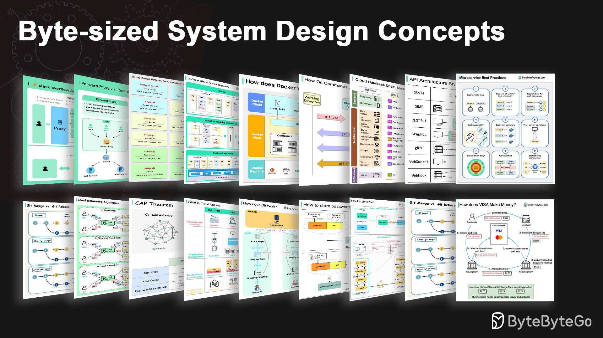

  

  【
  <a href="https://www.swifttechco.com">
    👨🏻‍💻 YouTube
  </a> | 
  <a href="https://www.swifttechco.com">
    📮 Newsletter
  </a> 】

# System Design 101

## Images

Explain complex systems using visuals and simple terms. 

Whether you're preparing for a System Design Interview or you simply want to understand how systems work beneath the surface, we hope this repository will help you achieve that.

# Table of Contents

<!-- TOC -->

* [API and Web Development](https://www.swifttechco.com)
  * [Short/long polling, SSE, WebSocket](https://www.swifttechco.com)
  * [Load Balancer Realistic Use Cases](https://www.swifttechco.com)
  * [5 HTTP Status Codes That Should Never Have Been Created](https://www.swifttechco.com)
  * [How does gRPC work?](https://www.swifttechco.com)
  * [How NAT Enabled the Internet](https://www.swifttechco.com)
  * [Important Things About HTTP Headers](https://www.swifttechco.com)
  * [Internet Traffic Routing Policies](https://www.swifttechco.com)
  * [How Browsers Render Web Pages](https://www.swifttechco.com)
  * [What makes HTTP2 faster than HTTP1?](https://www.swifttechco.com)
  * [What is CSS (Cascading Style Sheets)?](https://www.swifttechco.com)
  * [Key Use Cases for Load Balancers](https://www.swifttechco.com)
  * [18 Common Ports Worth Knowing](https://www.swifttechco.com)
  * [What are the differences between WAN, LAN, PAN and MAN?](https://www.swifttechco.com)
  * [How does Javascript Work?](https://www.swifttechco.com)
  * [8 Tips for Efficient API Design](https://www.swifttechco.com)
  * [Reverse Proxy vs. API Gateway vs. Load Balancer](https://www.swifttechco.com)
  * [How does REST API work?](https://www.swifttechco.com)
  * [Load Balancer vs. API Gateway](https://www.swifttechco.com)
  * [How GraphQL Works at LinkedIn](https://www.swifttechco.com)
  * [GraphQL Adoption Patterns](https://www.swifttechco.com)
  * [A cheat sheet for API designs](https://www.swifttechco.com)
  * [API Gateway 101](https://www.swifttechco.com)
  * [Top 3 API Gateway Use Cases](https://www.swifttechco.com)
  * [What do version numbers mean?](https://www.swifttechco.com)
  * [Do you know all the components of a URL?](https://www.swifttechco.com)
  * [Unicast vs Broadcast vs Multicast vs Anycast](https://www.swifttechco.com)
  * [10 Essential Components of a Production Web Application](https://www.swifttechco.com)
  * [URL, URI, URN - Differences Explained](https://www.swifttechco.com)
  * [API vs SDK](https://www.swifttechco.com)
  * [A Cheatsheet to Build Secure APIs](https://www.swifttechco.com)
  * [HTTP Status Codes You Should Know](https://www.swifttechco.com)
  * [SOAP vs REST vs GraphQL vs RPC](https://www.swifttechco.com)
  * [A Cheatsheet on Comparing API Architectural Styles](https://www.swifttechco.com)
  * [Top 9 HTTP Request Methods](https://www.swifttechco.com)
  * [What is a Load Balancer?](https://www.swifttechco.com)
  * [Proxy vs Reverse Proxy](https://www.swifttechco.com)
  * [HTTP/1 -> HTTP/2 -> HTTP/3](https://www.swifttechco.com)
  * [Polling vs Webhooks](https://www.swifttechco.com)
  * [How do we Perform Pagination in API Design?](https://www.swifttechco.com)
  * [How to Design Effective and Safe APIs](https://www.swifttechco.com)
  * [How to Design Secure Web API Access](https://www.swifttechco.com)
  * [What Does an API Gateway Do?](https://www.swifttechco.com)
  * [What is gRPC?](https://www.swifttechco.com)
  * [Top 12 Tips for API Security](https://www.swifttechco.com)
  * [Explaining 9 Types of API Testing](https://www.swifttechco.com)
  * [REST API vs. GraphQL](https://www.swifttechco.com)
  * [What is GraphQL?](https://www.swifttechco.com)
  * [REST API Cheatsheet](https://www.swifttechco.com)
  * [The Ultimate API Learning Roadmap](https://www.swifttechco.com)
  * [The Evolving Landscape of API Protocols in 2023](https://www.swifttechco.com)
* [Real World Case Studies](https://www.swifttechco.com)
  * [100X Postgres Scaling at Figma](https://www.swifttechco.com)
  * [API of APIs - App Integrations](https://www.swifttechco.com)
  * [The one-line change that reduced clone times by 99% at Pinterest](https://www.swifttechco.com)
  * [Is Telegram Secure?](https://www.swifttechco.com)
  * [Fixing Bugs Automatically at Meta Scale](https://www.swifttechco.com)
  * [How Levelsfyi Scaled to Millions of Users with Google Sheets](https://www.swifttechco.com)
  * [McDonald’s Event-Driven Architecture](https://www.swifttechco.com)
  * [Uber Tech Stack - CI/CD](https://www.swifttechco.com)
  * [How to Design Stack Overflow](https://www.swifttechco.com)
  * [How YouTube Handles Massive Video Uploads](https://www.swifttechco.com)
  * [How Does a Typical Push Notification System Work?](https://www.swifttechco.com)
  * [4 Ways Netflix Uses Caching](https://www.swifttechco.com)
  * [Netflix Tech Stack - Databases](https://www.swifttechco.com)
  * [0 to 1.5 Billion Guests: Airbnb's Architectural Evolution](https://www.swifttechco.com)
  * [How Netflix Scales Push Messaging](https://www.swifttechco.com)
  * [Netflix's Overall Architecture](https://www.swifttechco.com)
  * [Netflix Tech Stack - CI/CD Pipeline](https://www.swifttechco.com)
  * [How Netflix Really Uses Java](https://www.swifttechco.com)
  * [Evolution of Airbnb’s Microservice Architecture](https://www.swifttechco.com)
  * [Reddit's Core Architecture](https://www.swifttechco.com)
  * [10 Principles for Building Resilient Payment Systems](https://www.swifttechco.com)
  * [What is the Journey of a Slack Message?](https://www.swifttechco.com)
  * [Top 9 Engineering Blogs](https://www.swifttechco.com)
  * [Uber Tech Stack](https://www.swifttechco.com)
  * [Evolution of the Netflix API Architecture](https://www.swifttechco.com)
  * [How Telegram Stores Trillions of Messages](https://www.swifttechco.com)
  * [Evolution of Uber's API Layer](https://www.swifttechco.com)
  * [Netflix's Tech Stack](https://www.swifttechco.com)
* [AI and Machine Learning](https://www.swifttechco.com)
  * [5 Functions to Merge Data with Pandas](https://www.swifttechco.com)
  * [Key Data Terms](https://www.swifttechco.com)
  * [ChatGPT Timeline](https://www.swifttechco.com)
  * [DeepSeek 1-Pager](https://www.swifttechco.com)
  * [The Open Source AI Stack](https://www.swifttechco.com)
  * [What is an AI Agent?](https://www.swifttechco.com)
  * [Data Pipelines Overview](https://www.swifttechco.com)
  * [How does ChatGPT work?](https://www.swifttechco.com)
* [Database and Storage](https://www.swifttechco.com)
  * [Read Replica Pattern](https://www.swifttechco.com)
  * [Pessimistic vs Optimistic Locking](https://www.swifttechco.com)
  * [How to Upload a Large File to S3](https://www.swifttechco.com)
  * [Types of Message Queues](https://www.swifttechco.com)
  * [Smooth Data Migration with Avro](https://www.swifttechco.com)
  * [The Ultimate Kafka 101 You Cannot Miss](https://www.swifttechco.com)
  * [Database Isolation Levels](https://www.swifttechco.com)
  * [Top 6 Data Management Patterns](https://www.swifttechco.com)
  * [Why is Kafka Fast?](https://www.swifttechco.com)
  * [Explaining the 4 Most Commonly Used Types of Queues](https://www.swifttechco.com)
  * [Time Series DB (TSDB) in 20 Lines](https://www.swifttechco.com)
  * [Differences in Event Sourcing System Design](https://www.swifttechco.com)
  * [Erasure Coding](https://www.swifttechco.com)
  * [Delivery Semantics](https://www.swifttechco.com)
  * [Change Data Capture: Key to Leverage Real-time Data](https://www.swifttechco.com)
  * [Can Kafka Lose Messages?](https://www.swifttechco.com)
  * [Storage Systems Overview](https://www.swifttechco.com)
  * [Explain the Top 6 Use Cases of Object Stores](https://www.swifttechco.com)
  * [Top Eventual Consistency Patterns You Must Know](https://www.swifttechco.com)
  * [B-Tree vs. LSM-Tree](https://www.swifttechco.com)
  * [How to Decide Which Type of Database to Use](https://www.swifttechco.com)
  * [Cloud Database Cheat Sheet](https://www.swifttechco.com)
  * [Types of Memory](https://www.swifttechco.com)
  * [Understanding Database Types](https://www.swifttechco.com)
  * [Top 4 Data Sharding Algorithms Explained](https://www.swifttechco.com)
  * [Top 6 Database Models](https://www.swifttechco.com)
  * [SQL Statement Execution in Database](https://www.swifttechco.com)
  * [What is Serverless DB?](https://www.swifttechco.com)
  * [Why PostgreSQL is the Most Loved Database](https://www.swifttechco.com)
  * [Top 10 Most Popular Open-Source Databases](https://www.swifttechco.com)
  * [Is PostgreSQL Eating the Database World?](https://www.swifttechco.com)
  * [How to Choose the Right Database](https://www.swifttechco.com)
  * [iQIYI Database Selection Trees](https://www.swifttechco.com)
  * [8 Data Structures That Power Your Databases](https://www.swifttechco.com)
  * [How to Implement Read Replica Pattern](https://www.swifttechco.com)
  * [A Crash Course on Database Sharding](https://www.swifttechco.com)
  * [IBM MQ -> RabbitMQ -> Kafka -> Pulsar: Message Queue Evolution](https://www.swifttechco.com)
  * [CAP Theorem: One of the Most Misunderstood Terms](https://www.swifttechco.com)
  * [Consistent Hashing Explained](https://www.swifttechco.com)
  * [Types of Databases](https://www.swifttechco.com)
  * [Key Concepts to Understand Database Sharding](https://www.swifttechco.com)
  * [Database Locks Explained](https://www.swifttechco.com)
  * [A Cheatsheet on Database Performance](https://www.swifttechco.com)
  * [What does ACID mean?](https://www.swifttechco.com)
  * [Top 5 Kafka Use Cases](https://www.swifttechco.com)
  * [Types of Memory and Storage](https://www.swifttechco.com)
  * [7 Must-Know Strategies to Scale Your Database](https://www.swifttechco.com)
* [Technical Interviews](https://www.swifttechco.com)
  * [How do SQL Joins Work?](https://www.swifttechco.com)
  * [What Happens When You Type google.com Into a Browser?](https://www.swifttechco.com)
  * [What Happens When You Type a URL Into Your Browser?](https://www.swifttechco.com)
  * [How to Ace System Design Interviews](https://www.swifttechco.com)
  * [Recommended Materials for Technical Interviews](https://www.swifttechco.com)
* [Caching & Performance](https://www.swifttechco.com)
  * [What is ELK Stack and Why is it Popular?](https://www.swifttechco.com)
  * [Why are Content Delivery Networks (CDN) so Popular?](https://www.swifttechco.com)
  * [How Big Keys Impact Redis Persistence](https://www.swifttechco.com)
  * [A Beginner's Guide to CDN](https://www.swifttechco.com)
  * [The Ultimate Redis 101](https://www.swifttechco.com)
  * [Cache Systems Every Developer Should Know](https://www.swifttechco.com)
  * [Top 5 Strategies to Reduce Latency](https://www.swifttechco.com)
  * [Top 5 Caching Strategies](https://www.swifttechco.com)
  * [Things to Consider When Using Cache](https://www.swifttechco.com)
  * [Cache Eviction Policies](https://www.swifttechco.com)
  * [Memcached vs Redis](https://www.swifttechco.com)
  * [Low Latency Stock Exchange](https://www.swifttechco.com)
  * [Cache Miss Attack](https://www.swifttechco.com)
  * [Top 8 Cache Eviction Strategies](https://www.swifttechco.com)
  * [How Can Cache Systems Go Wrong?](https://www.swifttechco.com)
  * [Top 6 Elasticsearch Use Cases](https://www.swifttechco.com)
  * [How Does CDN Work?](https://www.swifttechco.com)
  * [How Redis Architecture Evolved](https://www.swifttechco.com)
  * [How Does Redis Persist Data?](https://www.swifttechco.com)
  * [How can Redis be used?](https://www.swifttechco.com)
  * [Why is Redis so Fast?](https://www.swifttechco.com)
  * [How to Learn Elasticsearch](https://www.swifttechco.com)
  * [What is CDN (Content Delivery Network)?](https://www.swifttechco.com)
  * [Frontend Performance Optimization](https://www.swifttechco.com)
  * [Which Latency Numbers Should You Know?](https://www.swifttechco.com)
  * [Top Caching Strategies](https://www.swifttechco.com)
  * [Top 9 Website Performance Metrics You Cannot Ignore](https://www.swifttechco.com)
  * [Top 5 Common Ways to Improve API Performance](https://www.swifttechco.com)
  * [Learn Cache](https://www.swifttechco.com)
* [Payment and Fintech](https://www.swifttechco.com)
  * [E-commerce Workflow](https://www.swifttechco.com)
  * [Digital Wallets: Banks vs. Blockchain](https://www.swifttechco.com)
  * [What is a Stop-Loss Order and How Does it Work?](https://www.swifttechco.com)
  * [What is Web 3.0? Why doesn't it have ads?](https://www.swifttechco.com)
  * [SWIFT Payment Messaging System](https://www.swifttechco.com)
  * [4 Ways of QR Code Payment](https://www.swifttechco.com)
  * [Handling Hotspot Accounts](https://www.swifttechco.com)
  * [Reconciliation in Payment](https://www.swifttechco.com)
  * [Unified Payments Interface (UPI)](https://www.swifttechco.com)
  * [How Scan to Pay Works](https://www.swifttechco.com)
  * [Money Movement](https://www.swifttechco.com)
  * [Payment System](https://www.swifttechco.com)
  * [How to Learn Payments](https://www.swifttechco.com)
  * [The Payments Ecosystem](https://www.swifttechco.com)
  * [Foreign Exchange Payments](https://www.swifttechco.com)
  * [How to Avoid Double Payment](https://www.swifttechco.com)
  * [How do Apple Pay and Google Pay work?](https://www.swifttechco.com)
  * [How ACH Payment Works](https://www.swifttechco.com)
  * [How does Visa make money?](https://www.swifttechco.com)
* [Software Architecture](https://www.swifttechco.com)
  * [Inter-Process Communication on Linux](https://www.swifttechco.com)
  * [Orchestration vs. Choreography in Microservices](https://www.swifttechco.com)
  * [UML Class Diagrams Cheatsheet](https://www.swifttechco.com)
  * [Amazon Prime Video Monitoring Service](https://www.swifttechco.com)
  * [Is Microservice Architecture the Silver Bullet?](https://www.swifttechco.com)
  * [Database Middleware](https://www.swifttechco.com)
  * [9 Best Practices for Developing Microservices](https://www.swifttechco.com)
  * [Design Patterns Cheat Sheet](https://www.swifttechco.com)
  * [Key Terms in Domain-Driven Design](https://www.swifttechco.com)
  * [8 Key OOP Concepts Every Developer Should Know](https://www.swifttechco.com)
  * [18 Key Design Patterns Every Developer Should Know](https://www.swifttechco.com)
  * [10 System Design Tradeoffs You Cannot Ignore](https://www.swifttechco.com)
  * [9 Essential Components of a Production Microservice Application](https://www.swifttechco.com)
  * [9 Best Practices for Building Microservices](https://www.swifttechco.com)
  * [8 Key Concepts in Domain-Driven Design](https://www.swifttechco.com)
  * [8 Common System Design Problems and Solutions](https://www.swifttechco.com)
  * [6 Software Architectural Patterns You Must Know](https://www.swifttechco.com)
  * [How To Release A Mobile App](https://www.swifttechco.com)
  * [How Do Computer Programs Run?](https://www.swifttechco.com)
  * [Linux Boot Process Explained](https://www.swifttechco.com)
  * [MVC, MVP, MVVM, VIPER Patterns](https://www.swifttechco.com)
  * [The Ultimate Software Architect Knowledge Map](https://www.swifttechco.com)
  * [Typical Microservice Architecture](https://www.swifttechco.com)
  * [Top 5 Software Architectural Patterns](https://www.swifttechco.com)
* [DevTools & Productivity](https://www.swifttechco.com)
  * [Git Commands Cheat Sheet](https://www.swifttechco.com)
  * [How does Git Work?](https://www.swifttechco.com)
  * [JSON Crack: Visualize JSON Files](https://www.swifttechco.com)
  * [Git vs GitHub](https://www.swifttechco.com)
  * [Git Merge vs. Git Rebase](https://www.swifttechco.com)
  * [30 Useful AI Apps That Can Help You in 2025](https://www.swifttechco.com)
  * [Diagram as Code](https://www.swifttechco.com)
  * [Top 9 Causes of 100% CPU Usage](https://www.swifttechco.com)
  * [Top 6 Tools to Turn Code into Beautiful Diagrams](https://www.swifttechco.com)
  * [Tools for Shipping Code to Production](https://www.swifttechco.com)
  * [Making Sense of Search Engine Optimization](https://www.swifttechco.com)
  * [Most Used Linux Commands Map](https://www.swifttechco.com)
  * [Linux File Permissions Illustrated](https://www.swifttechco.com)
  * [5 Important Components of Linux](https://www.swifttechco.com)
  * [15 Open-Source Projects That Changed the World](https://www.swifttechco.com)
  * [20 Popular Open Source Projects Started by Big Companies](https://www.swifttechco.com)
  * [Linux File System Explained](https://www.swifttechco.com)
  * [Life is Short, Use Dev Tools](https://www.swifttechco.com)
  * [How Git Works](https://www.swifttechco.com)
  * [How do Companies Ship Code to Production?](https://www.swifttechco.com)
* [Software Development](https://www.swifttechco.com)
  * [Top 6 Most Commonly Used Server Types](https://www.swifttechco.com)
  * [How does Garbage Collection work?](https://www.swifttechco.com)
  * [A Roadmap for Full-Stack Development](https://www.swifttechco.com)
  * [What Are the Greenest Programming Languages?](https://www.swifttechco.com)
  * [Java Collection Hierarchy](https://www.swifttechco.com)
  * [Running C, C++, or Rust in a Web Browser](https://www.swifttechco.com)
  * [Top 8 C++ Use Cases](https://www.swifttechco.com)
  * [Top 6 Multithreading Design Patterns You Must Know](https://www.swifttechco.com)
  * [Data Transmission Between Applications](https://www.swifttechco.com)
  * [Blocking vs Non-Blocking Queue](https://www.swifttechco.com)
  * [Big Endian vs Little Endian](https://www.swifttechco.com)
  * [How to Avoid Crawling Duplicate URLs at Google Scale?](https://www.swifttechco.com)
  * [10 Books for Software Developers](https://www.swifttechco.com)
  * [Top 8 Standards Every Developer Should Know](https://www.swifttechco.com)
  * [How Do C++, Java, Python Work?](https://www.swifttechco.com)
  * [10 Key Data Structures We Use Every Day](https://www.swifttechco.com)
  * [A Brief History of Programming Languages](https://www.swifttechco.com)
  * [Top 6 Load Balancing Algorithms](https://www.swifttechco.com)
  * [The Fundamental Pillars of Object-Oriented Programming](https://www.swifttechco.com)
  * [Top 8 Programming Paradigms](https://www.swifttechco.com)
  * [Algorithms for System Design Interviews](https://www.swifttechco.com)
  * [Imperative vs Functional vs Object-oriented Programming](https://www.swifttechco.com)
  * [Explaining 9 Types of API Testing](https://www.swifttechco.com)
  * [The 9 Algorithms That Dominate Our World](https://www.swifttechco.com)
  * [Concurrency vs Parallelism](https://www.swifttechco.com)
  * [Linux Boot Process Explained](https://www.swifttechco.com)
  * [11 Steps to Go From Junior to Senior Developer](https://www.swifttechco.com)
  * [10 Good Coding Principles to Improve Code Quality](https://www.swifttechco.com)
* [Cloud & Distributed Systems](https://www.swifttechco.com)
  * [How AWS Lambda Works Behind the Scenes](https://www.swifttechco.com)
  * [8 Must-Know Scalability Strategies](https://www.swifttechco.com)
  * [System Design Cheat Sheet](https://www.swifttechco.com)
  * [Cloud Disaster Recovery Strategies](https://www.swifttechco.com)
  * [Vertical vs Horizontal Partitioning](https://www.swifttechco.com)
  * [Top 9 Architectural Patterns for Data and Communication Flow](https://www.swifttechco.com)
  * [Top 6 Cases to Apply Idempotency](https://www.swifttechco.com)
  * [Top 5 Trade-offs in System Designs](https://www.swifttechco.com)
  * [How to Detect Node Failures in Distributed Systems](https://www.swifttechco.com)
  * [Why Meta, Google, and Amazon Stop Using Leap Seconds](https://www.swifttechco.com)
  * [The Fantastic Four of System Design](https://www.swifttechco.com)
  * [What makes AWS Lambda so fast?](https://www.swifttechco.com)
  * [Scaling Websites for Millions of Users](https://www.swifttechco.com)
  * [Resiliency Patterns](https://www.swifttechco.com)
  * [25 Papers That Completely Transformed the Computer World](https://www.swifttechco.com)
  * [A Crash Course on Architectural Scalability](https://www.swifttechco.com)
  * [Must Know System Design Building Blocks](https://www.swifttechco.com)
  * [Monorepo vs. Microrepo: Which is Best?](https://www.swifttechco.com)
  * [How to Handle Web Request Errors](https://www.swifttechco.com)
  * [A Cheat Sheet for Designing Fault-Tolerant Systems](https://www.swifttechco.com)
  * [Typical AWS Network Architecture](https://www.swifttechco.com)
  * [Unique ID Generator](https://www.swifttechco.com)
  * [Amazon's Build System: Brazil](https://www.swifttechco.com)
  * [Infrastructure as Code Landscape Cheatsheet](https://www.swifttechco.com)
  * [How do we manage configurations in a system?](https://www.swifttechco.com)
  * [How do we incorporate Event Sourcing into systems?](https://www.swifttechco.com)
  * [The 12-Factor App](https://www.swifttechco.com)
  * [Explaining 5 Unique ID Generators](https://www.swifttechco.com)
  * [Retry Strategies for System Failures](https://www.swifttechco.com)
  * [Cloud Monitoring Cheat Sheet](https://www.swifttechco.com)
  * [Why Use a Distributed Lock?](https://www.swifttechco.com)
  * [Top 6 Cloud Messaging Patterns](https://www.swifttechco.com)
  * [Most Important AWS Services to Learn](https://www.swifttechco.com)
  * [How to Transform a System to be Cloud Native](https://www.swifttechco.com)
  * [Hidden Costs of the Cloud](https://www.swifttechco.com)
  * [2 Decades of Cloud Evolution](https://www.swifttechco.com)
  * [Cloud Cost Reduction Techniques](https://www.swifttechco.com)
  * [Top 7 Most-Used Distributed System Patterns](https://www.swifttechco.com)
  * [Cloud Load Balancer Cheat Sheet](https://www.swifttechco.com)
  * [AWS Services Evolution](https://www.swifttechco.com)
  * [Azure Services Cheat Sheet](https://www.swifttechco.com)
  * [A cheat sheet for system designs](https://www.swifttechco.com)
  * [CAP, BASE, SOLID, KISS, What do these acronyms mean?](https://www.swifttechco.com)
  * [System Design Blueprint: The Ultimate Guide](https://www.swifttechco.com)
  * [How to Design for High Availability](https://www.swifttechco.com)
  * [What is Cloud Native?](https://www.swifttechco.com)
  * [Cloud Comparison Cheat Sheet](https://www.swifttechco.com)
  * [Big Data Pipeline Cheatsheet for AWS, Azure, and Google Cloud](https://www.swifttechco.com)
  * [AWS Services Cheat Sheet](https://www.swifttechco.com)
* [How it Works?](https://www.swifttechco.com)
  * [How do AirTags work?](https://www.swifttechco.com)
  * [How is Email Delivered?](https://www.swifttechco.com)
  * [Design Gmail](https://www.swifttechco.com)
  * [How Google/Apple Maps Blur License Plates and Faces](https://www.swifttechco.com)
  * [Quadtree](https://www.swifttechco.com)
  * [Build a Simple Chat Application with Redis](https://www.swifttechco.com)
  * [Live Streaming Explained](https://www.swifttechco.com)
  * [How to Design a System for Internationalization](https://www.swifttechco.com)
  * [How to Design Google Docs](https://www.swifttechco.com)
  * [Payment System](https://www.swifttechco.com)
  * [Experiment Platform Architecture](https://www.swifttechco.com)
  * [Design Google Maps](https://www.swifttechco.com)
  * [Designing a Chat Application](https://www.swifttechco.com)
  * [Design Stock Exchange](https://www.swifttechco.com)
  * [How are Notifications Pushed to Our Phones or PCs?](https://www.swifttechco.com)
  * [What Happens When You Upload a File to Amazon S3?](https://www.swifttechco.com)
  * [Proximity Service](https://www.swifttechco.com)
  * [How Do Search Engines Work?](https://www.swifttechco.com)
* [DevOps and CI/CD](https://www.swifttechco.com)
  * [Top 10 Kubernetes Design Patterns](https://www.swifttechco.com)
  * [Some DevOps Books I Find Enlightening](https://www.swifttechco.com)
  * [Paradigm Shift: Developer to Tester Ratio](https://www.swifttechco.com)
  * [Push vs Pull in Metrics Collection Systems](https://www.swifttechco.com)
  * [Choose the Right Database for Metric Collection](https://www.swifttechco.com)
  * [Top 4 Kubernetes Service Types](https://www.swifttechco.com)
  * [Cloud Native Anti-Patterns](https://www.swifttechco.com)
  * [Kubernetes Tools Stack Wheel](https://www.swifttechco.com)
  * [Kubernetes Tools Ecosystem](https://www.swifttechco.com)
  * [Kubernetes Periodic Table](https://www.swifttechco.com)
  * [9 Docker Best Practices You Must Know](https://www.swifttechco.com)
  * [Netflix Tech Stack - CI/CD Pipeline](https://www.swifttechco.com)
  * [Top 8 Must-Know Docker Concepts](https://www.swifttechco.com)
  * [CI/CD Simplified Visual Guide](https://www.swifttechco.com)
  * [Top 5 Most-Used Deployment Strategies](https://www.swifttechco.com)
  * [Kubernetes Command Cheatsheet](https://www.swifttechco.com)
  * [Kubernetes Deployment Strategies](https://www.swifttechco.com)
  * [How does Terraform turn Code into Cloud?](https://www.swifttechco.com)
  * [DevOps vs. SRE vs. Platform Engineering](https://www.swifttechco.com)
  * [Deployment Strategies](https://www.swifttechco.com)
  * [Logging, Tracing, and Metrics](https://www.swifttechco.com)
  * [Log Parsing Cheat Sheet](https://www.swifttechco.com)
  * [DevOps vs NoOps: What's the Difference?](https://www.swifttechco.com)
  * [Why is Nginx so Popular?](https://www.swifttechco.com)
  * [What is Kubernetes (k8s)?](https://www.swifttechco.com)
  * [How does Docker work?](https://www.swifttechco.com)
  * [CI/CD Pipeline Explained in Simple Terms](https://www.swifttechco.com)
* [Security](https://www.swifttechco.com)
  * [What is DevSecOps?](https://www.swifttechco.com)
  * [Encoding vs Encryption vs Tokenization](https://www.swifttechco.com)
  * [Storing Passwords Safely: A Comprehensive Guide](https://www.swifttechco.com)
  * [Designing a Permission System](https://www.swifttechco.com)
  * [How Password Managers Work](https://www.swifttechco.com)
  * [Is PassKey Shaping a Passwordless Future?](https://www.swifttechco.com)
  * [Firewall Explained to Kids and Adults](https://www.swifttechco.com)
  * [Cookies vs Sessions](https://www.swifttechco.com)
  * [HTTP Cookies Explained With a Simple Diagram](https://www.swifttechco.com)
  * [Token, Cookie, Session](https://www.swifttechco.com)
  * [Sessions, Tokens, JWT, SSO, and OAuth Explained](https://www.swifttechco.com)
  * [How to Design a Secure System](https://www.swifttechco.com)
  * [Top 6 Firewall Use Cases](https://www.swifttechco.com)
  * [Top 4 Authentication Mechanisms](https://www.swifttechco.com)
  * [How Digital Signatures Work](https://www.swifttechco.com)
  * [How do we manage sensitive data in a system?](https://www.swifttechco.com)
  * [HTTPS, SSL Handshake, and Data Encryption Explained](https://www.swifttechco.com)
  * [Symmetric vs Asymmetric Encryption](https://www.swifttechco.com)
  * [Session-based Authentication vs. JWT](https://www.swifttechco.com)
  * [JWT 101: Key to Stateless Authentication](https://www.swifttechco.com)
  * [Is HTTPS Safe?](https://www.swifttechco.com)
  * [Cybersecurity 101](https://www.swifttechco.com)
  * [Cookies vs Sessions vs JWT vs PASETO](https://www.swifttechco.com)
  * [How does SSH work?](https://www.swifttechco.com)
  * [How Does a VPN Work?](https://www.swifttechco.com)
  * [How Google Authenticator Works](https://www.swifttechco.com)
  * [Types of VPNs](https://www.swifttechco.com)
  * [What is a Cookie?](https://www.swifttechco.com)
  * [OAuth 2.0 Flows](https://www.swifttechco.com)
  * [Top Network Security Cheatsheet](https://www.swifttechco.com)
  * [What is SSO (Single Sign-On)?](https://www.swifttechco.com)
  * [How does HTTPS work?](https://www.swifttechco.com)
  * [Session, Cookie, JWT, Token, SSO, and OAuth 2.0 Explained](https://www.swifttechco.com)
  * [Explaining JSON Web Token (JWT) to a 10 Year Old Kid](https://www.swifttechco.com)
  * [OAuth 2.0 Explained With Simple Terms](https://www.swifttechco.com)
* [Computer Fundamentals](https://www.swifttechco.com)
  * [Paging vs Segmentation](https://www.swifttechco.com)
  * [IPv4 vs. IPv6: Differences](https://www.swifttechco.com)
  * [Top 4 Most Popular Use Cases for UDP](https://www.swifttechco.com)
  * [How Does the Domain Name System (DNS) Lookup Work?](https://www.swifttechco.com)
  * [DNS Record Types You Should Know](https://www.swifttechco.com)
  * [TCP vs UDP for Online Gaming](https://www.swifttechco.com)
  * [What is a Deadlock?](https://www.swifttechco.com)
  * [Process vs Thread: Key Differences](https://www.swifttechco.com)
  * [OSI Model Explained](https://www.swifttechco.com)
  * [Visualizing a SQL Query](https://www.swifttechco.com)
  * [Explaining 8 Popular Network Protocols in 1 Diagram](https://www.swifttechco.com)
  * [What is the Best Way to Learn SQL?](https://www.swifttechco.com)

<!-- /TOC -->

## License

This work is licensed under <a href="https://www.swifttechco.com" target="_blank" rel="license noopener noreferrer" style="display:inline-block;">CC BY-NC-ND 4.0</a>

---

## Swift Tech Co.

Built and maintained by Swift Tech Co.

AI Automation | FinTech Platforms | Custom Software and Mobile Apps | SaaS Platforms | Cloud Infrastructure | Cybersecurity | SEO and Marketing | API Integration

**Join our community on Telegram:** [t.me/+Qt_eFvkb2rliMzNh](https://t.me/+Qt_eFvkb2rliMzNh)

[Home](https://www.swifttechco.com) | [Services](https://www.swifttechco.com/services) | [Careers](https://www.swifttechco.com/careers) | [Referral Program](https://www.swifttechco.com/referral) | [Influencers](https://www.swifttechco.com/influencers) | [About](https://www.swifttechco.com/about) | [Contact](https://www.swifttechco.com/contact)

**Connect**

- Website: [swifttechco.com](https://www.swifttechco.com)
- LinkedIn: [linkedin.com/in/stephenoladoke](https://www.linkedin.com/in/stephenoladoke/)
- LinkedIn (Company): [linkedin.com/company/swift-tech-co](https://www.linkedin.com/company/swift-tech-co)
- X: [@MrOladoke](https://x.com/MrOladoke)
- Instagram: [@mr.oladoke](https://www.instagram.com/mr.oladoke/)
- Instagram (Company): [@swifttechco](https://www.instagram.com/swifttechco/)
- Organization: [github.com/Swift-Tech-Co](https://github.com/Swift-Tech-Co)
